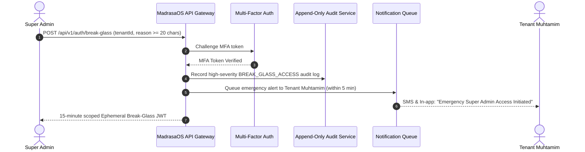

# RBAC Matrix & Access Control Policy — MadrasaOS AI v3.0

## 1. Principles of Access Control
1. **Permission-Key Architecture**: Server and API middleware never evaluate role strings directly (e.g. `if (role === 'teacher')`). Instead, authorization checks evaluate discrete permission keys (e.g. `req.user.hasPermission('exam:marks:enter')`).
2. **Repository-Level Multi-Tenancy**: The repository layer automatically attaches `madrasa_id` to all queries. UI element suppression is purely for UX; the API enforces access control unconditionally.
3. **Institutional Hierarchy**:
   - Only **Muhtamim / Principal** can perform `result:publish` or `result:unpublish`.
   - **Exam Controller** prepares tabulation, audits marks, and rejects erroneous entries, but cannot publish.
   - **Majlis-e-Ilmi (`majlis-e-ilmi`)** edits curriculum, subjects, syllabus, and book mappings. Standard teachers have read-only access.
   - **Students & Guardians** can only view own published results and own Hifz progress.

---

## 2. Role-to-Permission Matrix

| Permission Key | Description | Super Admin (System) | Muhtamim / Principal | Exam Controller | Majlis-e-Ilmi | Teacher | Student / Guardian |
| :--- | :--- | :---: | :---: | :---: | :---: | :---: | :---: |
| `hifz:read` | View all class Hifz progress | Break-glass | ✅ | ❌ | ❌ | ✅ (Assigned) | ❌ |
| `hifz:read:own` | View own/child Hifz journey | Break-glass | ✅ | ❌ | ❌ | ✅ | ✅ |
| `hifz:entry` | Log Sabak, Sabki, Amukhta, Dour | Break-glass | ✅ | ❌ | ❌ | ✅ (Assigned) | ❌ |
| `hifz:alert:configure`| Configure mistake & absence thresholds | Break-glass | ✅ | ❌ | ❌ | ❌ | ❌ |
| `hifz:alert:resolve` | Mark student Hifz alerts resolved | Break-glass | ✅ | ❌ | ❌ | ✅ | ❌ |
| `academic:read` | View classes, subjects, book goals | Break-glass | ✅ | ✅ | ✅ | ✅ | ❌ |
| `academic:edit` | Add/modify books, syllabus, goals | Break-glass | ✅ | ❌ | ✅ | ❌ | ❌ |
| `academic:approve` | Approve curriculum & terms | Break-glass | ✅ | ❌ | ❌ | ❌ | ❌ |
| `timetable:read` | View routine / schedule | Break-glass | ✅ | ✅ | ✅ | ✅ | ✅ (Published) |
| `timetable:edit` | Drag-and-drop slots & resolve conflicts| Break-glass | ✅ | ❌ | ✅ | ❌ | ❌ |
| `timetable:publish`| Publish new timetable version | Break-glass | ✅ | ❌ | ✅ | ❌ | ❌ |
| `exam:read` | View list of exams & terms | Break-glass | ✅ | ✅ | ❌ | ✅ | ❌ |
| `exam:create` | Create exam & define subjects | Break-glass | ✅ | ✅ | ❌ | ❌ | ❌ |
| `exam:schedule` | Define exam room, date & seat plan | Break-glass | ✅ | ✅ | ❌ | ❌ | ❌ |
| `exam:marks:enter` | Enter marks for assigned subjects | Break-glass | ✅ | ❌ | ❌ | ✅ (Assigned) | ❌ |
| `exam:marks:audit` | Audit subject marks & view tabulation | Break-glass | ✅ | ✅ | ❌ | ❌ | ❌ |
| `exam:marks:reject`| Reject subject marks with reason | Break-glass | ✅ | ✅ | ❌ | ❌ | ❌ |
| `exam:approve` | Approve audited exam results | Break-glass | ✅ | ❌ | ❌ | ❌ | ❌ |
| `exam:publish` | Publish results & lock marks | Break-glass | ✅ | ❌ | ❌ | ❌ | ❌ |
| `exam:unpublish` | Unpublish exam (blocked on re-eval)| Break-glass | ✅ | ❌ | ❌ | ❌ | ❌ |
| `exam:tabulation:read`| Access full class tabulation sheet | Break-glass | ✅ | ✅ | ❌ | ❌ | ❌ |
| `exam:marksheet:read`| Access student marksheets | Break-glass | ✅ | ✅ | ❌ | ✅ (Own class) | ❌ |
| `result:read` | View final result ledgers | Break-glass | ✅ | ✅ | ❌ | ✅ (Own class) | ❌ |
| `result:read:own` | View own published result card | Break-glass | ✅ | ❌ | ❌ | ❌ | ✅ (Published) |
| `result:re-evaluate:request`| Submit re-evaluation appeal | Break-glass | ❌ | ❌ | ❌ | ❌ | ✅ |
| `result:re-evaluate:review` | Review & recompute mark appeal | Break-glass | ✅ | ✅ | ❌ | ❌ | ❌ |
| `audit:read` | View tenant audit logs | Break-glass | ✅ | ❌ | ❌ | ❌ | ❌ |
| `settings:read` | View institutional settings | Break-glass | ✅ | ❌ | ❌ | ❌ | ❌ |
| `settings:edit` | Modify institutional settings | Break-glass | ✅ | ❌ | ❌ | ❌ | ❌ |
| `user:manage` | Manage staff accounts and roles | Break-glass | ✅ | ❌ | ❌ | ❌ | ❌ |

---

## 3. Super Admin Break-Glass Protocol

Super Admin accounts hold `madrasa_id = NULL` and operate at the infrastructure level. They cannot arbitrarily browse or manipulate tenant records. Emergency intervention triggers a strict break-glass flow:

